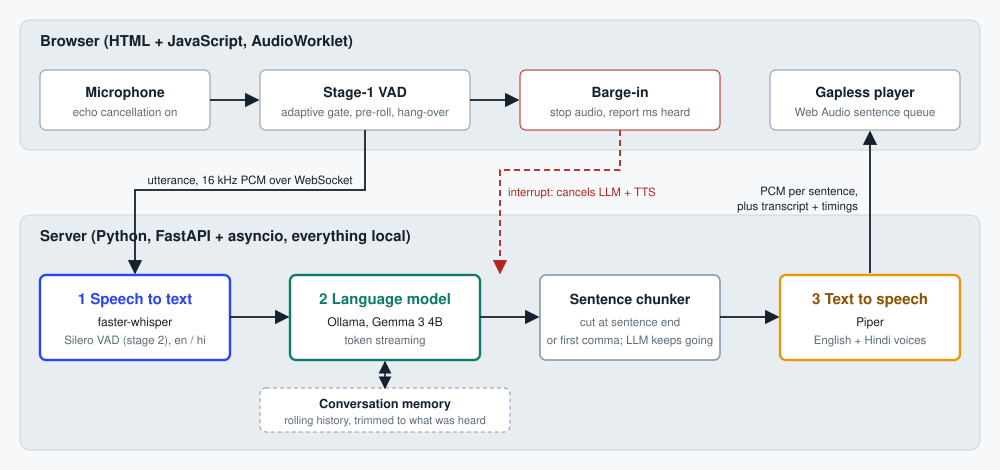

# Open-weight voice assistant (STT -> LLM -> TTS)

[](https://github.com/77Pratham/voice-assistant/actions/workflows/tests.yml)
[](https://colab.research.google.com/github/77Pratham/voice-assistant/blob/main/colab/voice_assistant_colab.ipynb)

A real-time voice assistant that runs entirely on open-weight models that I host myself. Talk to it in **English or
Hindi**, hear a spoken answer, interrupt it whenever you like, and watch the latency of every stage live in the UI.
Built for the Trikon Software Labs AI internship assignment.

**Demo video:** [add link here]

| Stage | Model | Runs via |
|---|---|---|
| Speech to text | Whisper large-v3-turbo (GPU) or small/base (CPU) | faster-whisper |
| Language model | Gemma 3 4B (any Ollama model works) | Ollama |
| Text to speech | Piper, English and Hindi voices | piper-tts |

No paid or hosted AI APIs are used for any stage.

## Results at a glance

Measured with `scripts/benchmark.py` on a free Google Colab T4 (full output: [docs/BENCHMARK_RESULTS.md](docs/BENCHMARK_RESULTS.md)).
Medians over 6 runs per language with synthetic test speech.

| | Speech to text | First audio (server) | Estimated perceived* |
|---|---:|---:|---:|
| English | 676 ms | 1.24 s | ~1.9 s |
| Hindi | 750 ms | 1.44 s | ~2.1 s |

\*Includes the 650 ms end-of-speech wait. In my browser sessions the tunnel from Colab to India added roughly another
0.5 s, which the app's latency panel shows separately. On my CPU-only laptop (llama3.2 + Whisper base) replies took
roughly 7-8 s (informal observation, not a benchmark). The benchmark also runs a 3-turn conversation to check memory.



## Requirements covered

- [x] Whisper-family STT, open-weight LLM, local Piper TTS, integrated in one conversational web app
- [x] Context across turns (rolling history, trimmed to what the user actually heard)
- [x] Latency work: sentence-level LLM->TTS streaming, model warm-up, Ollama `keep_alive`, live latency panel, benchmark script
- [x] Bonus: streaming responses, voice activity detection (browser + Silero), interruptions (barge-in), Hindi + English with automatic language detection
- [x] Python (FastAPI) backend, plain JavaScript front end, Dockerfile, tests with CI

## Quick start (local)

Python 3.10-3.13.

```bash
# 1. Install Ollama (https://ollama.com), then pull the LLM
ollama pull gemma3:4b            # or a smaller model such as llama3.2 on weak hardware

# 2. Python environment
python -m venv .venv
source .venv/bin/activate        # Windows: .venv\Scripts\activate
pip install -r requirements.txt

# 3. Download the Piper voices (en + hi) and the Whisper model
python scripts/download_models.py

# 4. Run
python -m app
```

Open <http://localhost:8000>, press the microphone button and talk. A headset gives the most reliable interruption
handling. You can also type a message; it goes through the same LLM -> TTS path. On a CPU-only machine put
`LLM_MODEL=llama3.2:latest` and `WHISPER_MODEL=base` in a `.env` file for faster (but less accurate) replies.

## Run on a free GPU (Google Colab)

If your machine is too slow, open `colab/voice_assistant_colab.ipynb` in Colab (badge above), choose a **T4 GPU**
runtime and run the cells in order. It installs Ollama and this app on the Colab VM (a self-managed instance, no
hosted AI APIs), runs Whisper large-v3-turbo and Gemma 3 4B on the GPU, and prints an HTTPS link to open on your
laptop (browsers only allow the microphone on HTTPS or localhost). Free Colab GPUs are not guaranteed and sessions
are temporary. The same approach works on any GPU server: `ssh -L 8000:localhost:8000 user@server`.

## Using it

- **Language:** automatic by default (English/Hindi); force one in the settings panel.
- **Interrupt:** start talking while it is speaking. Playback stops immediately and generation is cancelled.
- **Wait after you stop talking:** about 650 ms works well; much lower values can split your sentence.
- **Microphone sensitivity / level bar:** the bar under the status text shows what the browser hears.
- **Latency panel:** time from the end of your speech to the first sound, split into stages.

## Configuration

Copy `.env.example` to `.env`. The most useful settings:

| Variable | Default | Notes |
|---|---|---|
| `LLM_MODEL` | `gemma3:4b` | any Ollama model tag |
| `WHISPER_MODEL` | `auto` | `auto` = large-v3-turbo on CUDA, small on CPU; or `base`, `medium`, ... |
| `WHISPER_DEVICE` | `auto` | `cpu` / `cuda` |
| `VOICE_EN`, `VOICE_HI` | lessac-medium, pratham-medium | any Piper voice name |
| `LLM_MAX_TOKENS` | `220` | shorter = faster replies |
| `TTS_LENGTH_SCALE` | `1.0` | below 1.0 speaks faster |
| `SAVE_UTTERANCES` | `false` | save received clips to `logs/utterances/` to debug recognition |

## Models, hardware and latency

See [docs/MODELS_AND_LATENCY.md](docs/MODELS_AND_LATENCY.md) for the model rationale, hardware guidance and tuning.

```bash
python scripts/benchmark.py            # writes docs/BENCHMARK_RESULTS.md (latency + multi-turn memory check)
python scripts/summarize_latency.py    # p50/p95 of real sessions, from logs/latency.jsonl
```

## How it works

Details and design decisions: [docs/ARCHITECTURE.md](docs/ARCHITECTURE.md). The LLM, the sentence chunker and TTS run
concurrently, so the first sentence is spoken while the rest is still being written, and an interruption cancels the
whole chain. Speech detection is two-stage (adaptive energy gate in the browser, Silero VAD inside faster-whisper).
When you interrupt, the browser reports how much audio it actually played so the conversation memory keeps only what
you heard.

## Project layout

```
app/            backend (config, stt, llm, tts, pipeline, session, server) and static web UI
scripts/        download_models.py, benchmark.py, summarize_latency.py
tests/          pytest suite (fake models) + tests/js/vad.test.js (client VAD / barge-in)
docs/           architecture diagram, models & latency notes, benchmark results, demo script
colab/          notebook for running on a free Colab GPU
Dockerfile, docker-compose.yml, .github/workflows/tests.yml
```

## Tests

```bash
pip install -r requirements-dev.txt
pytest                         # 53 tests: chunking, sessions, pipeline, barge-in, WebSocket protocol, STT/TTS wrappers
node tests/js/vad.test.js      # 6 checks of the browser VAD and interruption logic
```

The suite uses fake models, so it runs anywhere and in CI without downloads.

## Docker

```bash
docker compose up -d
docker compose exec ollama ollama pull gemma3:4b
docker compose run --rm app python scripts/download_models.py
```

## Status and limitations

- Run end to end by the author: the full pipeline with a microphone in the browser on a Colab T4, and the benchmark above.
- The Docker setup is provided but has not been tested.
- STT is utterance-based (no partial transcripts), so the end-of-speech wait is part of perceived latency.
- Hindi recognition is good but not perfect (the benchmark shows small word errors); Piper's Hindi voice is less
  expressive than the English one. Romanised Hindi is read with the English voice.
- One conversation per WebSocket and no authentication: intended for local use or an SSH tunnel.

## Troubleshooting

- *"Can't reach the language model"*: start Ollama (`ollama serve`) and check `ollama list` shows your model.
- *Microphone blocked*: use `localhost` or HTTPS, and allow the permission in the address bar.
- *"Didn't catch that" or empty transcripts*: the microphone is probably too quiet. Raise the input volume in your OS
  sound settings, raise the sensitivity slider, or use a headset mic. The level bar should move clearly while you talk.
- *It answers itself / interrupts itself*: use a headset or lower the speaker volume.
- *`libcublas.so.12 is not found` on a GPU machine*: `pip install nvidia-cublas-cu12 nvidia-cudnn-cu12` (the app preloads them), or set `WHISPER_DEVICE=cpu`.
- *Hindi sounds wrong*: use `WHISPER_MODEL=medium` (or large-v3-turbo on GPU); small is the weakest for Hindi.

## Licences and credits

The code in this repository is MIT licensed (see `LICENSE`). Models are downloaded separately under their own terms:
Whisper and faster-whisper (MIT), Piper (MIT; each voice has its own licence on its Hugging Face model card),
Gemma 3 (Google's Gemma Terms of Use), Ollama (MIT).
